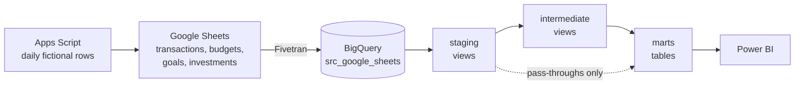
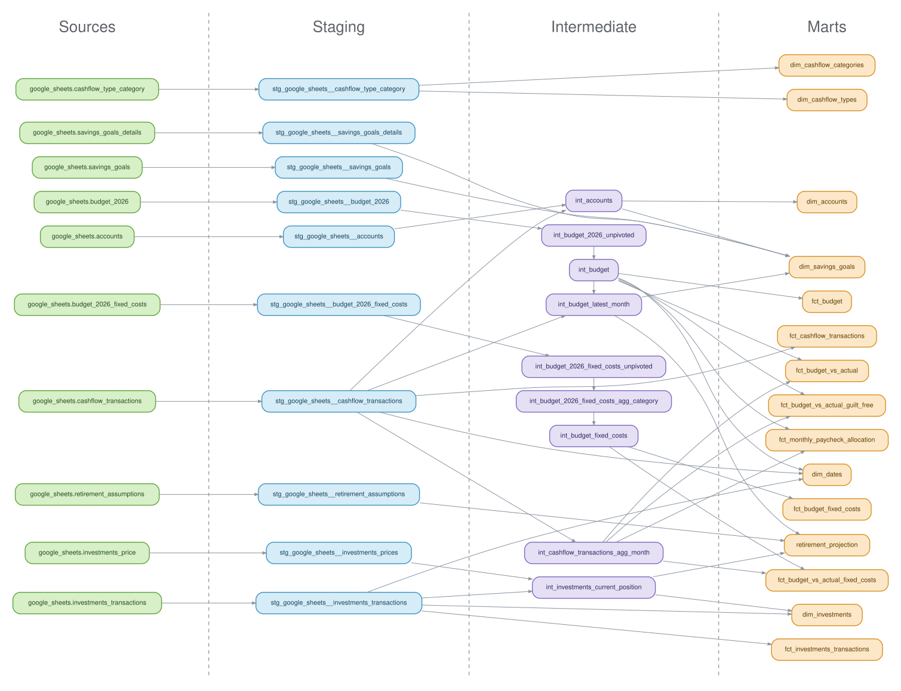

# personal_finances_dbt

A dbt project that turns a couple's manually logged finances (transactions, budget, savings goals, investments) into clean, tested tables for budgeting and long-term planning. It runs on BigQuery and is built and deployed with dbt Cloud.

This repository holds the **dbt transformations**. The story behind the project, the Google Sheets template, the Power BI dashboards and the slide deck live in the companion repository: [clayamakita/personal_finances](https://github.com/clayamakita/personal_finances).

> **All data is fictional.** The people in this project (Kenji and Mei), their accounts and their transactions are made up. No real financial data is in this repository.

> **Work in progress.** The project is being brought up to a documented standard, one small pull request at a time. [Project status](#project-status) says what is in place and what is still planned, and this README only describes things that exist today.

## Contents

- [What the project answers](#what-the-project-answers)
- [Project status](#project-status)
- [Architecture](#architecture)
- [Data sources](#data-sources)
- [Keeping the data fresh](#keeping-the-data-fresh)
- [Models](#models)
- [Business rules worth knowing](#business-rules-worth-knowing)
- [Requirements](#requirements)
- [How to run](#how-to-run)
- [Project conventions](#project-conventions)
- [Testing](#testing)
- [How to add a new budget year](#how-to-add-a-new-budget-year)
- [Decisions](#decisions)

## What the project answers

The models are built around three groups of questions:

| Theme | Question | Where to look |
|---|---|---|
| **Enjoy life** | Are we on budget this month? How much Guilt-Free spending is left? | `fct_budget_vs_actual`, `fct_budget_vs_actual_guilt_free`, `fct_budget_vs_actual_fixed_costs` |
| **Enjoy life** | Did each paycheck get allocated to Fixed Costs, Savings, Investments and Guilt-Free? | `fct_monthly_paycheck_allocation` |
| **Achieve goals** | Which savings goals are funded, and when can we afford the next one? | `dim_savings_goals` |
| **Build wealth** | What is each investment worth, and what return is it earning? | `dim_investments`, `fct_investments_transactions` |
| **Build wealth** | Will we be okay at retirement? | `retirement_projection` |

The budget follows a spending plan adapted from Ramit Sethi's Conscious Spending Plan. Take-home pay is split into four buckets, and every transaction is tagged to one of them: **Fixed Costs**, **Savings**, **Investments** and **Guilt-Free**. The companion repository explains the plan in detail.

## Project status

The project started as a working set of models and is being improved in phases. Each change is a pull request that is checked against a baseline build, so refactors prove that the data did not change.

**In place**

- A [style guide](STYLE_GUIDE.md), and SQL and YAML formatted with SQLFluff and Prettier.
- Documentation: a grain statement ("One row per ...") on every model, consistent column descriptions and shared doc blocks.
- Shared macros for date parsing, readable keys, unpivoting budgets, the budget rules and "today" in the project timezone.
- Tests: `unique`, `not_null`, `accepted_values` and `relationships`, plus reconciliation tests on budgets, account balances and projections.
- Correctness fixes to the paycheck allocation, the savings-goal logic and the budget-vs-actual future months.
- Baseline tooling: a Production build of `main` and analyses that compare a development build with it.
- A daily feed of fictional data, so the sources keep changing (see [Keeping the data fresh](#keeping-the-data-fresh)).

**Planned**

- Source freshness checks.
- More correctness fixes: unbudgeted fixed-cost spending, the `dim_dates` range, investment positions and the retirement projection.
- Enforced contracts on the marts, unit tests, and renaming reporting models with an `rpt_` prefix.
- Separate BigQuery datasets per layer.
- A CI job on every pull request and a project evaluator check.
- Architecture decision records and a lineage graph image.

## Architecture



| Layer | Materialization | Purpose |
|---|---|---|
| Staging | view | One model per source table. Renames, explicit casts, date parsing. No business logic. |
| Intermediate | view | Reusable logic: unpivoting budgets, aggregating transactions, building keys. Not for consumers. |
| Marts | table | The tables a dashboard reads. Dimensions (`dim_`) and facts (`fct_`), plus the retirement projection. |

Today every layer builds into the single dataset of its environment: `analytics` in Production, and your own development dataset in the dbt Cloud IDE. Separate datasets per layer (`staging`, `intermediate`, `marts`) are planned.

<details>
<summary>dbt DAG (click to expand)</summary>

[](https://clayamakita.github.io/personal_finances_dbt/lineage.html)

*Click the graph to explore it interactively.*

</details>

## Data sources

All data is entered in Google Sheets and synced to BigQuery by Fivetran into the `src_google_sheets` dataset. A sheet template is available in the [companion repository](https://github.com/clayamakita/personal_finances).

| Source table | Contents |
|---|---|
| `accounts` | Financial accounts with beginning and current balances |
| `cashflow_transactions` | Every income, expense and transfer, with account, type and category |
| `cashflow_type_category` | The list of valid transaction types and categories |
| `budget_2026` | Monthly budget by type (Income, Fixed Costs, Savings, Investments, Guilt-Free), one column per month |
| `budget_2026_fixed_costs` | Monthly fixed-cost budget by item, one column per month |
| `savings_goals`, `savings_goals_details` | Savings goals, their priority and target amount |
| `investments_transactions`, `investments_price` | Buys, sells and dividends, and the latest price per holding |
| `retirement_assumptions` | Age, expected return, contribution and target for the retirement projection |

## Keeping the data fresh

The data is fictional, so a small Google Apps Script bound to the sheet adds a realistic day of rows every morning to the transactions and investments tabs. It follows rules taken from the existing data: biweekly paychecks, the savings and TFSA transfers that follow them, monthly bills, grocery trips, Guilt-Free spending, interest and cashback, credit card payments, and ETF purchases priced with the day's `GOOGLEFINANCE` closing price. It only adds days after the latest date in the sheet, so running it twice never duplicates rows, and it stops at the end of the 2026 budget.

Fivetran syncs the new rows, so the models always have something new to process. Freshness checks on the sources are planned.

<!-- TODO: link generate_transactions.gs here once it is published -->

## Models

| Layer | Examples |
|---|---|
| Staging | `stg_google_sheets__cashflow_transactions`, `stg_google_sheets__budget_2026` |
| Intermediate | `int_budget` (all budget years in one model), `int_cashflow_transactions_agg_month`, `int_investments_current_position` |
| Marts | `dim_accounts`, `dim_dates`, `fct_budget_vs_actual`, `fct_monthly_paycheck_allocation`, `dim_savings_goals`, `dim_investments`, `retirement_projection` |

Every model has a one-sentence **grain** at the start of its description ("One row per ..."). Browse them in dbt Cloud's catalog or with `dbt docs generate`.

## Business rules worth knowing

These decisions shape the numbers.

- **Currency and time.** Amounts are in CAD. "Today" means today in `America/Toronto` (the `project_timezone` variable), through the `today()` macro.
- **Guilt-Free spending is treated as allocated at its budget.** Whatever isn't spent carries over to the next month, and the running totals carry over across years.
- **Bonuses and extra paychecks** are categorized as `Paycheck`, so they show up as a positive Paycheck variance.
- **Future months are flagged.** `is_future_month` is true for months after the current one, so dashboards can hide months that haven't started instead of showing them as underspent. The current month stays visible with its spending so far.
- **"Latest month" follows the data**, not the calendar. It is the month of the latest transaction.
- **Readable keys.** Surrogate keys are built from the business values with the `slug_key` macro (for example `groceries_2026-03-01`), not hashes, so they can be read in query results.
- **Budgets are unpivoted per year** with a macro and combined in one stable model (`int_budget`), so downstream models never change when a year is added.

## Requirements

- **dbt Cloud** with the **v1 Latest** release track, using the Studio IDE. The project is plain dbt, so dbt Core should work too, but I only run it in dbt Cloud.
- **BigQuery**, with permission to create datasets and a user-defined function.
- **A BigQuery function named `xirr`.** An `on-run-start` hook (`calculate_annualized_return()`) creates it in the environment's dataset at the start of every run. `dim_investments` calls it to calculate annualized returns. It isn't visible in the lineage graph, so it is documented here.
- **Packages** (pinned in `packages.yml`): `dbt_utils`, `audit_helper` and `dbt_project_evaluator`. Run `dbt deps` to install them.
- **Fivetran** (or any process that loads the sheets into a `src_google_sheets` dataset with the same table names).

## How to run

### In dbt Cloud

1. Connect the project to BigQuery and this repository.
2. Create a **Development** environment (the Studio IDE) and a **Production** environment (deployment type *Production*, dataset `analytics`).
3. In the Studio IDE, run:

   ```
   dbt deps
   dbt build --exclude package:dbt_project_evaluator
   ```

4. Create a manual job, **Baseline: build main**, that runs the same two commands on `main` in Production. It is the reference for comparing changes (see [Testing](#testing)).

### With dbt Core

Create a `profiles.yml` entry (outside the repo) for BigQuery, then run the same commands.

Variables you can override in `dbt_project.yml` or with `--vars`:

| Variable | Default | Purpose |
|---|---|---|
| `project_timezone` | `America/Toronto` | Timezone used by the `today()` macro |
| `source_database` | the target project | BigQuery project holding the `src_google_sheets` dataset |

## Project conventions

Naming, SQL style, layer rules, testing and documentation standards are in [`STYLE_GUIDE.md`](STYLE_GUIDE.md). In short:

- `stg_<source>__<table>`, `int_<verb>_<noun>`, `dim_`, `fct_`.
- Lowercase SQL, 4-space indent, formatted by SQLFluff.
- Every model has a grain statement, and every primary key has `unique` and `not_null` tests.
- Marts are the only models meant for consumers. Enforced contracts on them are planned.

## Testing

What is tested today:

- **Generic tests:** `unique`, `not_null`, `accepted_values` and `relationships` (every fact points to a real account, type, category and date).
- **Singular tests** in `tests/`: reconciliations such as fixed-cost totals, account balances against the sheet, Guilt-Free variance, and valid type and category pairs.

How refactors are checked: **Baseline: build main** builds `main` in Production, and the analyses in `analyses/` compare a development build with it: one that compares every model at once, one that compares row counts and column sums, and one that shows the rows that differ for a single model. A refactor is accepted only when nothing differs, apart from a few columns that depend on live prices or today's date.

Planned: source freshness on every source table, unit tests for the logic-heavy models, and a dbt Cloud CI job that lints and builds every pull request and runs `dbt_project_evaluator`.

## How to add a new budget year

When a new year's budget sheet appears (for example 2027):

1. Add the new source tables to `_src_google_sheets.yml`.
2. Create `stg_google_sheets__budget_2027` and `stg_google_sheets__budget_2027_fixed_costs`.
3. Create the unpivoted intermediate models by calling the `unpivot_budget_months` macro.
4. Add them to the union in `int_budget` and `int_budget_fixed_costs`. Downstream models don't change.
5. Confirm `dim_dates` covers the year (its range comes from the data).
6. Run the tests and check there are no duplicate `budget_type` + `budget_month` combinations across years.
7. Update any descriptions that mention a specific year.
8. Move the end date of the data generator (`END_DATE` in the Apps Script) to the end of the new year.

The full checklist is in [`STYLE_GUIDE.md`](STYLE_GUIDE.md#11-new-budget-year-checklist).

## Decisions

Architecture decision records are planned. For now, the decisions that shape the project are:

- Readable surrogate keys through the `slug_key` macro, instead of hashes.
- Budgets are unpivoted per year and combined in one stable model.
- Guilt-Free spending is treated as allocated at its budget, and unspent amounts carry over across years.
- "Latest month" is driven by the latest transaction, not the calendar.
- Derived metrics stay in `dim_savings_goals` and `dim_investments`, as a documented exception to the "dimensions are descriptive" rule.

---

Built by [Clarissa Yamakita](https://github.com/clayamakita). The data, people and accounts are fictional.
